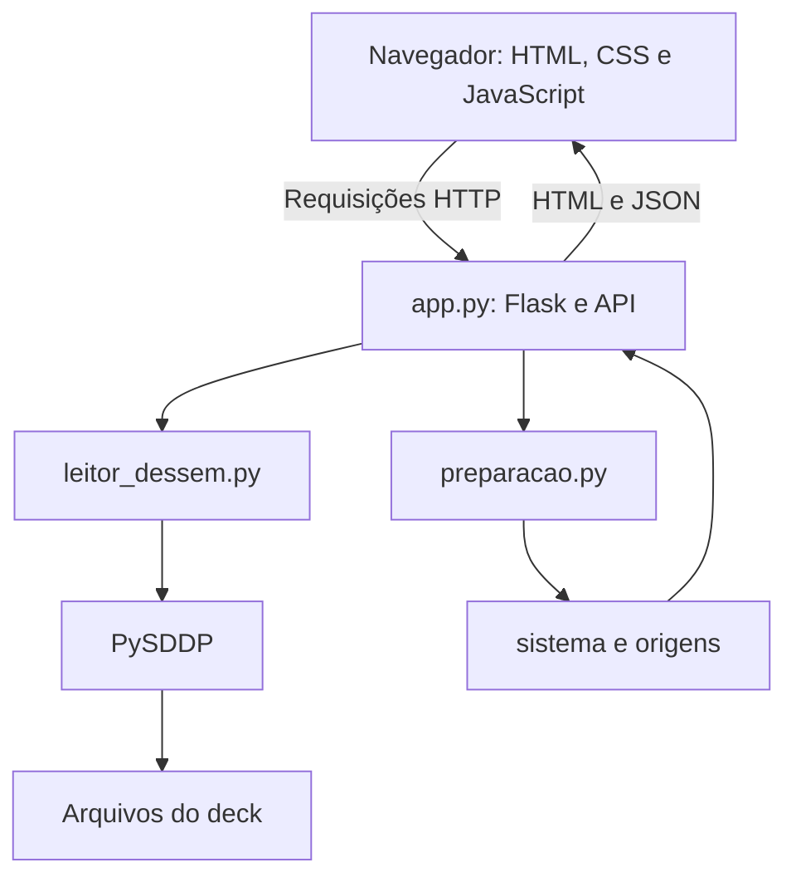

# Dashboard DESSEM

Aplicação local para explorar um deck DESSEM com o PySDDP, selecionar usinas e submercado e preparar um dicionário `sistema` para um modelo de despacho hidrotérmico.

**Estado atual:** leitura de catálogos, seleção pelo dashboard e preparação com defaults explícitos. A aplicação ainda não executa otimização nem reproduz todas as condições operativas do DESSEM.

## 1. Funcionalidades implementadas

- Carregamento do deck padrão de **29/10/2026** (`DS_CCEE_102026_SEMREDE_RV4D29`) ou de outro deck por diretório.
- Listagem e seleção múltipla de usinas hidrelétricas (UHEs) e termelétricas (UTEs).
- Busca nas listas por parte do nome ou código, ignorando acentos e diferenças entre maiúsculas e minúsculas.
- Preservação das seleções ao alterar a busca, com indicação das usinas selecionadas fora do filtro e botão para limpar a seleção.
- Listagem de submercados a partir do registro `SIST` do `ENTDADOS`, excluindo por padrão os subsistemas fictícios.
- Geração de `sistema` com as chaves `Geral`, `UHE` e `UTE`.
- Visualização de tabelas, do dicionário gerado e da origem dos campos/defaults.
- Verificações básicas de consistência antes de devolver o sistema.

## 2. Executar localmente

### Dependências

- Python 3 e um ambiente virtual.
- Flask para servir a interface e disponibilizar a API HTTP.
- PySDDP para leitura do deck. Os adaptadores foram conferidos com a versão **0.0.90**; outras versões podem exigir ajustes nos atributos e nas colunas.
- Navegador e uma pasta com o deck completo, incluindo `dessem.arq` e seus arquivos referenciados.

### Instalação no Windows / PowerShell

Execute os comandos na pasta principal do projeto. A criação do ambiente é necessária apenas na primeira configuração.

```powershell
python -m venv .venv
.\.venv\Scripts\Activate.ps1
python -m pip install Flask PySDDP==0.0.90
```

Quando o ambiente já estiver configurado, ative-o e inicie a aplicação:

```powershell
.\.venv\Scripts\Activate.ps1
python app.py
```

Abra [http://127.0.0.1:5000](http://127.0.0.1:5000) e mantenha o terminal em execução. Use `Ctrl + C` para encerrar o servidor.

O projeto utiliza o servidor local de desenvolvimento do Flask. O navegador recebe os arquivos da interface e faz requisições ao Python; abrir `index.html` diretamente não disponibiliza as rotas da API nem processa os templates do Flask.

### Localização do deck

Por padrão, a pasta `DS_CCEE_102026_SEMREDE_RV4D29` deve estar ao lado de `app.py`. Essa configuração está em:

```python
app.config["DECK_PADRAO"] = (
    BASE_DIR / "DS_CCEE_102026_SEMREDE_RV4D29"
)
```

Para outro local, selecione **Usar outro deck por diretório** no dashboard. O caminho é lido pelo processo Python e precisa existir no computador em que ele está rodando. Caminhos relativos informados nessa opção são resolvidos a partir da pasta de `app.py`.

A referência de data exibida após o carregamento é obtida de `caso.dadvaz.data_hora`. Se ela não estiver disponível, será exibido `não identificada`; outros decks não recebem automaticamente a data de 29/10/2026.

## 3. Usar o dashboard

1. Escolha a origem e clique em **Carregar deck**.
2. Busque e selecione as UHEs e UTEs. Use `Ctrl + clique` para selecionar várias opções na mesma lista.
3. Selecione o submercado.
4. Clique em **Gerar sistema**.
5. Confira as tabelas e expanda **Ver dicionário sistema em JSON** e **Ver origem dos dados e defaults utilizados**.

A busca ocorre no JavaScript sobre os catálogos já recebidos. Digitar no filtro não relê o deck nem faz uma requisição para cada tecla. A quantidade selecionada inclui as usinas fora do filtro atual.

Alterar uma seleção invalida o resultado mostrado até gerar o sistema novamente. Trocar a origem ou o diretório invalida o deck carregado e limpa os catálogos/seleções da interface.

## 4. Organização do projeto

| Arquivo | Responsabilidade |
| --- | --- |
| [app.py](app.py) | Configurar o Flask, servir a página, receber requisições, guardar o deck em memória e coordenar leitura e preparação. |
| [leitor_dessem.py](leitor_dessem.py) | Abrir o deck com o PySDDP e transformar seus cadastros em listas de dicionários. |
| [preparacao.py](preparacao.py) | Mapear as usinas selecionadas para o formato `sistema`, aplicar defaults, informar origens e validar a estrutura. |
| [templates/index.html](templates/index.html) | Definir a estrutura da interface, os campos, as tabelas e os espaços para JSON. |
| [static/style.css](static/style.css) | Definir aparência, espaçamento e adaptação a telas menores. |
| [static/app.js](static/app.js) | Controlar os campos, as buscas e seleções, enviar requisições e apresentar as respostas. |

O frontend é composto por HTML, CSS e JavaScript. O backend é escrito em Python e usa Flask como framework para construir a API. O PySDDP é a biblioteca usada pelo backend para interpretar os arquivos do deck.



### Fluxo interno

1. `POST /api/deck/carregar` chama `carregar_deck()` e `listar_catalogos()`.
2. O Python mantém o objeto do deck e seus catálogos em memória, associados a um `deck_id` da sessão do navegador.
3. O JavaScript preenche os seletores e guarda as escolhas pelos códigos das usinas.
4. `POST /api/caso/preparar` valida os códigos recebidos e chama `montar_sistema()` somente com as usinas selecionadas.
5. A resposta contém `sistema`, `origens`, metadados e pendências. O JavaScript atualiza a tela.

A consulta reutiliza o deck já carregado. Reiniciar o servidor apaga essa memória e requer novo carregamento. Cada sessão mantém um deck atual: carregar outro substitui o anterior; abas que compartilharem a mesma sessão podem precisar recarregá-lo.

## 5. Dados extraídos e fontes

Leitura pelo PySDDP não significa que todos os campos já são utilizados pela preparação. Atualmente, o adaptador expõe:

| Fonte | Acesso no PySDDP | Dados utilizados |
| --- | --- | --- |
| `dessem.arq` | `Dessem(diretorio, "dessem.arq")` | Referências para os arquivos que compõem o deck. |
| `HIDR` | `caso.hidr`, em listas `campo["valor"]` | Código, nome, posto, jusante e volumes mínimo/máximo cadastrais das UHEs. |
| `TERMDAT`, bloco `CADUSIT` | `caso.cadterm.cadusit_df` | Código (`num_usi`) e nome das UTEs. É a fonte do dashboard atual. |
| `OPERUT`, blocos `OPER` e `INIT` | `caso.operut.limites_condicoes_df` e `condicoes_iniciais_df` | Alternativa para listar código (`us`) e nome das UTEs. |
| `ENTDADOS`, registro `SIST` | `caso.dadger.bloco_sist["df"]` | Código, sigla, nome e indicação de subsistema real/fictício. |
| `DADVAZ` | `caso.dadvaz.data_hora` | Data de referência do caso. A série de afluências ainda não é adaptada para `sistema`. |

Observações:

- O catálogo hidráulico contém registros nomeados do `HIDR`; ainda não é cruzado com `UH` para restringir a lista às UHEs representadas no estudo.
- Os limites cadastrais do `HIDR` ainda não recebem alterações de `AC` ou restrições operativas.
- A listagem alternativa de UTEs pelo `OPERUT` reúne os blocos `OPER` e `INIT` e elimina repetições por código. Isso não agrega suas condições operativas.
- Os caminhos de arquivos referenciados são definidos pelo deck; o nome físico do cadastro térmico pode variar.
- Alguns erros de leitura são capturados internamente pelo PySDDP. Confira também as mensagens no terminal; obter os catálogos não comprova a leitura completa de todos os arquivos.

## 6. Formato do dicionário `sistema`

A função principal de preparação é:

```python
sistema = montar_sistema(hidreletricas, termeletricas)
```

Os argumentos são as listas de dicionários das usinas selecionadas, já obtidas pelo leitor. A função não abre arquivos nem chama um otimizador.

A saída possui somente estas três chaves principais:

```python
sistema = {
    "Geral": {
        "Custo_def": custo_def,
        "Carga": carga,
        "Duracao_h": duracao_h,
        "Nr_Est": n_periodos,
    },
    "UHE": lista_uhe,
    "UTE": lista_ute,
}
```

O trecho acima ilustra a estrutura; os valores são montados por `preparacao.py`. Os campos e defaults atuais estão descritos abaixo.

### Geral

| Campo | Unidade / tipo | Origem atual |
| --- | --- | --- |
| `Custo_def` | R$/MWh | Default: `500.0`. |
| `Carga` | Lista de MW por intervalo | Perfil fictício de 24 valores horários; cada valor é repetido em duas meias horas. |
| `Duracao_h` | Lista de horas por intervalo | Default: `[0.5] * 48`. |
| `Nr_Est` | Inteiro | Calculado como `len(Duracao_h)`, atualmente `48`. |

O horizonte padrão soma 24 horas. `Nr_Est` representa intervalos, não meses. Os valores de `Carga` são potências médias por intervalo em MW; não são multiplicados pela duração nesta etapa.

**A seleção do submercado ainda não altera o perfil fictício de carga.** Ela é preservada nos metadados para a futura consulta dos registros `DP`.

### UHE

| Campo | Unidade / tipo | Origem atual |
| --- | --- | --- |
| `Nome` | Texto | Nome cadastral do `HIDR`. |
| `Vmin` | hm³ | `HIDR`, campo `vol_min`. |
| `Vmax` | hm³ | `HIDR`, campo `vol_max`. |
| `VI` | hm³ | Default calculado: `Vmin + 0.5 * (Vmax - Vmin)`. |
| `Prod` | MW/hm³ | Default constante definido em `preparacao.py`. |
| `Engol` | hm³ por intervalo | Default definido em `preparacao.py`. |
| `Afl` | Lista de hm³ por intervalo | Default constante definido em `preparacao.py`. |

O default de `VI` corresponde a 50% do volume útil. Ainda não é o volume inicial extraído do deck. A contribuição de montante e a cascata não são tratadas nesta preparação.

### UTE

Cada UTE selecionada é representada provisoriamente por um gerador equivalente. O código ainda não detalha as unidades geradoras reais e aplica o mesmo padrão a todas as UTEs.

| Campo | Unidade / tipo | Origem atual |
| --- | --- | --- |
| `Nome` | Texto | Nome extraído do catálogo térmico. |
| `Cap` | MW | Default: `15.0`. |
| `Pmin` | MW | Default: `5.0`. |
| `Custo` | R$/MWh | Default: `10.0`. |
| `Ton_h` | h | Default: `4.0`. |
| `Toff_h` | h | Default: `2.0`. |
| `Rup` | MW/h | Default: `4.0`. |
| `Rdown` | MW/h | Default: `6.0`. |
| `Status_inicial` | Inteiro: 0 desligado, 1 ligado | Default: `1`. |
| `Tempo_status_inicial_h` | h | Default: `2.0`. |
| `Geracao_inicial` | MW | Default: `8.0`. |
| `Traj_partida` | Pares `(tempo acumulado em h, potência em MW)` | Default: `[(0.5, 2.5), (1.0, 5.0)]`. |
| `Traj_parada` | Pares `(tempo acumulado em h, potência em MW)` | Default: `[(0.5, 2.5), (1.0, 0.0)]`. |
| `Trajetoria_inicial` | `None` nesta etapa | Default: `None`; início dentro de uma trajetória ainda não implementado. |

Esses defaults são placeholders do modelo, não parâmetros operativos extraídos das usinas selecionadas. As trajetórias são tuplas no Python e aparecem como arrays no JSON.

### Rastreabilidade e validação

- Os valores estão centralizados em `CARGA_HORARIA_PADRAO`, `DEFAULTS_GERAL`, `DEFAULTS_UHE` e `DEFAULTS_UTE`, em `preparacao.py`.
- `origens_dados()` descreve a origem de cada campo separadamente de `sistema`.
- `deepcopy()` cria listas independentes para evitar que alterações em uma usina afetem outras ou os defaults globais.
- `validar_sistema()` verifica números finitos, durações positivas, tamanhos das séries, limites de volume, potência mínima/máxima, status/geração inicial e consistência básica das trajetórias.
- Essas verificações não demonstram viabilidade do despacho nem equivalência com a formulação completa do DESSEM.

## 7. API HTTP

A interface e a API são atendidas pelo mesmo servidor local. As rotas `/api/` recebem e devolvem JSON.

| Método | Rota | Responsabilidade |
| --- | --- | --- |
| `GET` | `/` | Renderizar `templates/index.html`. |
| `GET` | `/static/<arquivo>` | Entregar os arquivos estáticos da interface. |
| `POST` | `/api/deck/carregar` | Ler o deck, obter catálogos e associá-los a um `deck_id`. |
| `POST` | `/api/caso/preparar` | Validar a seleção e montar `sistema` com defaults. |

### Carregar o deck

Exemplo de corpo para o deck padrão:

```json
{
  "origem_deck": "padrao",
  "diretorio_deck": null
}
```

Para outro diretório, use `origem_deck: "diretorio"` e informe a pasta em `diretorio_deck`.

A resposta inclui `deck_id`, `nome`, `data_referencia`, `uhe`, `ute`, `submercados`, `historico` e `avisos`. Os catálogos fornecem os códigos que devem ser enviados na preparação.

Atualmente `historico` retorna `{"anos": [], "permite_media": false}`. A escolha de ano ou média histórica permanece indisponível.

### Preparar a seleção

Exemplo ilustrativo: substitua os códigos pelos retornados no carregamento.

```json
{
  "deck_id": "IDENTIFICADOR_RETORNADO_NO_CARREGAMENTO",
  "codigos_uhe": ["10", "20"],
  "codigos_ute": ["1"],
  "codigo_submercado": "1",
  "fonte_afluencias": "deck",
  "ano_afluencias": null
}
```

As usinas são consultadas no catálogo guardado no servidor pelos códigos recebidos. O backend não usa nomes ou limites arbitrários enviados pelo navegador. A API atual aceita apenas `fonte_afluencias: "deck"`; essa é a fonte solicitada para implementação futura, enquanto `Afl` ainda utiliza default.

A resposta distingue:

| Campo | Conteúdo / significado |
| --- | --- |
| `sistema` | Dicionário `Geral`/`UHE`/`UTE` para o modelo. |
| `origens` | Procedência dos campos e descrição dos defaults. |
| `metadados` | Identificação do deck, data e submercado selecionado. |
| `selecao` | Códigos escolhidos e fonte de afluências solicitada. |
| `uhe`, `ute` | Dados da seleção para apresentar nas tabelas. |
| `etapa` | Atualmente `preparacao_com_defaults`. |
| `estrutura_validada` | `true` após as verificações de `validar_sistema()`. |
| `usa_defaults` | `true` na implementação atual. |
| `pronto_para_modelo` | `false`: ainda falta validar/adaptar os dados operativos reais do deck. Não significa que o dicionário deixou de ser gerado. |
| `pendencias` | Resumo das simplificações e extrações pendentes. |

Os campos externos `periodos`, `carga` e `afluencias` permanecem vazios porque ainda não representam séries extraídas do deck. As séries **default** utilizadas pelo modelo estão em `sistema["Geral"]` e `sistema["UHE"]`.

### Erros

Formato das respostas de erro da API:

```json
{
  "erro": "Descrição do problema"
}
```

| Status | Situações previstas |
| --- | --- |
| `400` | Entrada inválida, caminho/arquivo ausente, código desconhecido, fonte histórica indisponível ou inconsistência ao montar o sistema. |
| `409` | `deck_id` ausente, de outra sessão, substituído ou indisponível após reiniciar o servidor. |
| `415` | Requisição enviada sem um tipo de conteúdo JSON aceito pelo Flask. |
| `500` | Falha inesperada durante o carregamento; detalhes registrados no terminal. |

## 8. Consultar o leitor pelo terminal

Com o ambiente virtual ativado, substitua o caminho ilustrativo pelo diretório real:

```powershell
python leitor_dessem.py "C:\dados\DS_CCEE_102026_SEMREDE_RV4D29" --tipo todos
python leitor_dessem.py "C:\dados\DS_CCEE_102026_SEMREDE_RV4D29" --tipo submercados
python leitor_dessem.py "C:\dados\DS_CCEE_102026_SEMREDE_RV4D29" --tipo uhe --nome "Paraibuna"
python leitor_dessem.py "C:\dados\DS_CCEE_102026_SEMREDE_RV4D29" --tipo ute --fonte operut
```

`--nome` e `--codigo` podem ser usados com `--tipo uhe` ou `ute`. A busca por nome exige correspondência do nome cadastral normalizado; abreviações diferentes não são resolvidas automaticamente. Veja todas as opções com:

```powershell
python leitor_dessem.py --help
```

## 9. Desenvolvimento e diagnóstico

### Onde implementar cada alteração

| Alteração | Arquivo principal |
| --- | --- |
| Extrair outro campo de um arquivo do deck | `leitor_dessem.py` |
| Mapear um campo extraído para `sistema`, mudar defaults ou validações | `preparacao.py` |
| Mudar rotas, corpo/resposta da API ou coordenação do fluxo | `app.py` |
| Adicionar campos e áreas de exibição | `templates/index.html` |
| Mudar filtros, eventos e apresentação dinâmica das respostas | `static/app.js` |
| Alterar o visual | `static/style.css` |

Após alterar Python, encerre e execute `python app.py` novamente: a configuração atual usa `use_reloader=False`. Após alterar HTML/CSS/JavaScript, atualize o navegador com `Ctrl + F5`.

### Problemas comuns

| Sintoma | Verificação |
| --- | --- |
| `ModuleNotFoundError` | Confirme que o terminal usa a `.venv` com Flask e PySDDP instalados. |
| Diretório ou `dessem.arq` não encontrado | Confira o caminho configurado e se a pasta contém o deck completo. |
| Colunas/atributos do PySDDP ausentes | Confira a versão instalada e o resultado da leitura; os adaptadores usam o layout documentado acima. |
| Resposta HTML no lugar de JSON | Acesse o endereço do Flask e confira se o `app.py` atualizado está rodando. |
| Argumentos `--tipo`/`--fonte` não reconhecidos | Atualize também o bloco final de execução de `leitor_dessem.py`, não apenas suas funções. |
| Sessão/deck inválido após reiniciar ou trocar de deck em outra aba | Carregue novamente o deck antes de gerar o sistema. |

As verificações feitas durante o desenvolvimento utilizaram dados/arquivos sintéticos, leitores do PySDDP, o cliente de testes do Flask e simulação do DOM. Elas cobriram mapeamento, filtragem, preservação de seleções, respostas da API e consistência estrutural. Não há uma suíte de testes versionada nesta estrutura inicial. Registre separadamente os resultados de validação com decks reais.

### Arquivos locais no Git

Exemplo de padrões para o `.gitignore` na raiz do projeto:

```gitignore
.venv/
__pycache__/
*.py[cod]
/DS_CCEE_*/
```

O padrão do deck deve ser ajustado se suas pastas tiverem outro nome ou localização. Regras de ignore não removem arquivos que já estão sendo rastreados pelo Git.

## 10. Próximas etapas

- [ ] Cruzar o cadastro hidráulico com `UH` para identificar as usinas representadas no estudo.
- [ ] Extrair o volume inicial e considerar alterações cadastrais/restrições pertinentes.
- [ ] Obter a discretização temporal de `TM` e alinhar todas as séries ao horizonte escolhido.
- [ ] Extrair a demanda `DP` do submercado selecionado.
- [ ] Extrair e alinhar as afluências do `DADVAZ`, distinguindo vazões naturais e incrementais.
- [ ] Conectar uma base histórica para seleção de ano e cálculo de médias.
- [ ] Detalhar as unidades térmicas e seus parâmetros no `TERMDAT`.
- [ ] Adaptar condições iniciais, limites e custos do `OPERUT`.
- [ ] Adaptar trajetórias do arquivo de rampas e a condição de início dentro de uma trajetória.
- [ ] Tratar cascatas, usinas de montante não selecionadas e contribuições externas.
- [ ] Validar os dados preparados contra decks reais e criar testes versionados.
- [ ] Integrar o modelo de otimização após consolidar o contrato de dados.

## 11. Como manter este README atualizado

Ao implementar uma funcionalidade:

1. Atualize a lista de funcionalidades e marque a etapa correspondente no checklist.
2. Atualize a tabela de fontes com o arquivo, registro e atributo efetivamente usados.
3. Quando substituir um default por dado real, atualize o código, `origens_dados()` e a tabela do campo neste README.
4. Documente unidade, resolução temporal e qualquer simplificação aplicada.
5. Se mudar o contrato HTTP, atualize os exemplos de API e o JavaScript na mesma alteração.
6. Registre como a mudança foi conferida e com qual versão do PySDDP/deck.

Modelo opcional para registrar alterações futuras:

```markdown
### AAAA-MM-DD — Descrição da alteração

- Funcionalidade:
- Arquivo/registro de origem:
- Unidade e tratamento temporal:
- Defaults substituídos ou mantidos:
- Validação realizada:
```
